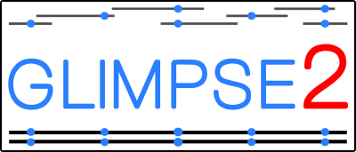

<p align="center">
  <a href="https://odelaneau.github.io/GLIMPSE/">
    
  </a>
  <h1 align="center">GLIMPSE2</h1>
  <p align="center">Phasing and imputation of low-coverage whole-genome sequencing data, designed for reference panels with hundreds of thousands of samples.</p>
</p>

[](https://github.com/odelaneau/GLIMPSE/releases)
[](https://github.com/odelaneau/GLIMPSE/releases)
[](http://bioconda.github.io/recipes/glimpse-bio/README.html)
[](https://anaconda.org/bioconda/glimpse-bio)
[](https://hub.docker.com/r/simrub/glimpse/)
[](https://github.com/odelaneau/GLIMPSE/blob/master/LICENSE)

**[Website](https://odelaneau.github.io/GLIMPSE/)** · **[Install](https://odelaneau.github.io/GLIMPSE/install/)** · **[Tutorial](https://odelaneau.github.io/GLIMPSE/tutorial/getting-started/)** · **[Documentation](https://odelaneau.github.io/GLIMPSE/tools/)** · **[Changelog](https://odelaneau.github.io/GLIMPSE/changelog/)**

### What is GLIMPSE2?

GLIMPSE2 phases and imputes genotypes from low-coverage whole-genome sequencing, using a reference panel of phased haplotypes. It builds on the [GLIMPSE model](https://www.nature.com/articles/s41588-020-00756-0), with an emphasis on rare variants and on reference panels with hundreds of thousands of samples.

- **Input:** low-coverage BAM/CRAM files or genotype likelihoods, and a phased reference panel.
- **Output:** phased and imputed genotypes for every sample.
- **Scale:** the chromosome is cut into chunks that are processed independently, so the one expensive step, `phase`, runs on all of them in parallel.

### How it works

`chunk` → `split_reference` (optional, once per panel) → `phase` (for each chunk, in parallel) → `ligate`

1. **`GLIMPSE2_chunk`** cuts the chromosome into chunks.
2. **`GLIMPSE2_split_reference`** converts the reference panel to the binary format. This step is optional: `phase` also reads a VCF/BCF panel directly, but the binary format gives major speedups on large panels. It is done once per panel and reused for any sample.
3. **`GLIMPSE2_phase`** imputes and phases your samples, once per chunk.
4. **`GLIMPSE2_ligate`** joins the imputed chunks into a chromosome.

Two more tools: **`GLIMPSE2_concordance`** measures imputation accuracy against high-coverage genomes, and **`GLIMPSE2_inspect`** summarises a binary reference panel.

Tutorials, documentation and installation instructions are on the [website](https://odelaneau.github.io/GLIMPSE/). The release history is in the [changelog](https://odelaneau.github.io/GLIMPSE/changelog/).

### GLIMPSE1 or GLIMPSE2?

For most applications, use GLIMPSE2. It is faster, handles much larger reference panels, and is the version we maintain.

[GLIMPSE1](https://odelaneau.github.io/GLIMPSE/glimpse1/index.html) has not been updated for a while, and we would not recommend it in general. It is only worth a look for its joint model, which helps with many samples at higher coverage (above 0.5x) and small reference panels, and which GLIMPSE2 does not have: GLIMPSE2 imputes from a reference panel only. The code is on the [GLIMPSE1 branch](https://github.com/odelaneau/GLIMPSE/tree/glimpse1).

### Related software

- [SHAPEIT5](https://odelaneau.github.io/shapeit5/) phases large sequencing cohorts, with a focus on rare variants. Use it to build the phased reference panel that GLIMPSE2 imputes from.
- [IMPUTE5](https://jmarchini.org/software/) imputes SNP array data against large reference panels.

### Building from source

GLIMPSE2 supports **Linux x86_64**, **Linux aarch64**, and **macOS ARM64 (Apple Silicon)**.

<details>
<summary><b>macOS (Apple Silicon)</b></summary>

```bash
brew install htslib boost libdeflate
git clone --recursive https://github.com/odelaneau/GLIMPSE.git
cd GLIMPSE
make system
```
</details>

<details>
<summary><b>Linux (Debian/Ubuntu)</b></summary>

```bash
sudo apt install build-essential libboost-iostreams-dev libboost-program-options-dev libboost-serialization-dev libhts-dev libdeflate-dev libbz2-dev liblzma-dev libcurl4-openssl-dev libssl-dev zlib1g-dev
git clone --recursive https://github.com/odelaneau/GLIMPSE.git
cd GLIMPSE
make system
```

On aarch64, also install `clang`: the build uses it by default there because it makes GLIMPSE2_phase much faster.
</details>

For detailed instructions including building dependencies from source, see the [step-by-step guide on the website](https://odelaneau.github.io/GLIMPSE/install/build/).

#### Docker image

Images for each release are on [Docker Hub](https://hub.docker.com/r/simrub/glimpse/), for linux/amd64 and linux/arm64. They contain all the GLIMPSE2 tools plus bcftools, bgzip and tabix, and the tags match the release versions:

```bash
docker pull simrub/glimpse:2.1.0
docker run --rm -v "$PWD":/data -w /data simrub/glimpse:2.1.0 GLIMPSE2_phase --help
```

To build the image yourself from a commit or tag, use `docker-build.sh`:

```bash
./docker-build.sh v2.1.0                             # glimpse:2.1.0 for this machine
./docker-build.sh v2.1.0 --push ghcr.io/me/glimpse   # both architectures, pushed to a registry
```

See the [Docker page on the website](https://odelaneau.github.io/GLIMPSE/install/docker/) for building by hand and the build options.

### Citation

If you use GLIMPSE2, please cite:

> Rubinacci S, Hofmeister RJ, Sousa da Mota B, Delaneau O. **Imputation of low-coverage sequencing data from 150,119 UK Biobank genomes.** *Nature Genetics* 55, 1088-1090 (2023). [doi:10.1038/s41588-023-01438-3](https://doi.org/10.1038/s41588-023-01438-3)

and the original method:

> Rubinacci S, Ribeiro DM, Hofmeister RJ, Delaneau O. **Efficient phasing and imputation of low-coverage sequencing data using large reference panels.** *Nature Genetics* 53, 120-126 (2021). [doi:10.1038/s41588-020-00756-0](https://doi.org/10.1038/s41588-020-00756-0)

### Acknowledgements

GLIMPSE is developed and maintained by Simone Rubinacci (University of Helsinki) and Olivier Delaneau (Regeneron).

We thank Tim Fennell and Fulcrum Genomics for the performance, memory, build and Docker work in 2.1, and Chris Kachulis and Michael Gatzen (Broad Institute) for improving cloud-computing support (checkpointing and retries) and bug fixes.

### License

GLIMPSE is available under the MIT license. For more information please see the [LICENSE](LICENSE).
