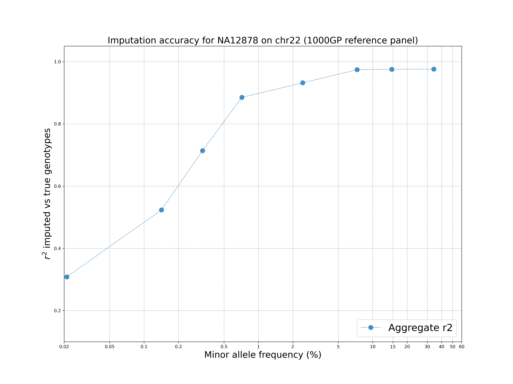

## Rationale
GLIMPSE2 is a set of tools that allow fast whole-genome imputation and phasing of low-coverage sequencing data.
We phase and impute independently different regions of each chromosome.

The pipeline for phasing and imputation is composed of four main steps:
1. **Split the chromosome into chunks**. We use [GLIMPSE2_chunk](../../tools/chunk/) to scan the position of the chromosome and define the regions where we perform imputation. This step usually takes a few seconds and produces a text file with all the imputation chunks.
2. **Split the reference panel in the GLIMPSE2 file format**. We use [GLIMPSE2_split_reference](../../tools/split_reference/) to split the reference panel using the GLIMPSE2 file format. Each chunk corresponds to an imputation window (plus buffer) and contains information about the genetic map. This step usually takes a few seconds to a few minutes, depending on the reference panel size.
3. **Run imputation and phasing**. Imputation and phasing is performed using [GLIMPSE2_phase](../../tools/phase/). GLIMPSE2_phase only requires the binary reference panel, a file containing the list of low-coverage BAM/CRAM files and the number of threads to use. Each job is typically run in parallel on a cluster (e.g. UKB RAP). This is the only computationally intensive step of GLIMPSE2.
4. **Ligate the imputed chunks to get a chromosome-wide file** When all imputation jobs for a chromosome are terminated successfully, we can simply run the [GLIMPSE2_ligate](../../tools/ligate/) tool to create phased chromosome-wide files. This step usually takes a few seconds to a few minutes, depending on the number of target samples and markers in the reference panel.

## Imputation using 1000GP reference panel
In this tutorial, we show how to run GLIMPSE2 from sequencing reads data (BAM/CRAM file) to obtain refined genotype and haplotype calls. A minimal set of data to run this pipeline containing chromosome 22 downsampled 1x sequencing reads for one individual (NA12878) is provided with GLIMPSE2 in the folder `GLIMPSE/tutorial/`. All datasets used here are in GRCh38/hg38 genome assembly.

### 1. Dataset and preliminaries

#### 1.1 Setting the environment and binaries
All scripts have been written assuming `GLIMPSE/tutorial/` as current directory. Therefore, we require to move to the tutorial directory:
```bash
cd GLIMPSE/tutorial/
```
The setup script builds the GLIMPSE tools needed here (chunk, split_reference, phase, ligate and concordance) with `make system`, and links the binaries into `tutorial/bin/`. It needs the libraries described in [Build from source](../../install/build/), so install them first:
```bash
./step1_script_setup.sh
```
If the script fails, build the tools following [Build from source](../../install/build/), or download the binaries from the [latest release](https://github.com/odelaneau/GLIMPSE/releases) and copy them into `./bin/`.

#### 1.2 Low coverage reads
In this example we downsampled the publicly available 30x data available for NA12878 provided by the Genome In A Bottle consortium (GIAB). We downloaded the full dataset, kept only chromosome 22 reads and downsampled to 1x. The resulting BAM file can be found in:

```bash
GLIMPSE/tutorial/NA12878_1x_bam/NA12878.bam[.bai]
```
Details of how we downsampled the dataset are provided in appendix section A1.1.

### 2. Reference panel preparation
In order to run accurate imputation we recommend to use a targeted reference with ancestry related to the target samples, if possible. For this tutorial we use the 1000 Genomes Project 30x NYGC reference panel. Since the reference panel contains data of our target sample and few relatives, we need to remove them from the reference panel. This steps downloads the 1000 genomes b38 data from the EBI ftp site.

#### 2.1 Download reference panel files
The 1000 Genomes Project reference panel is publicly available at EBI 1000 genomes ftp site. We can download chromosome 22 data using:

```bash
wget -c http://ftp.1000genomes.ebi.ac.uk/vol1/ftp/data_collections/1000G_2504_high_coverage/working/20201028_3202_phased/CCDG_14151_B01_GRM_WGS_2020-08-05_chr22.filtered.shapeit2-duohmm-phased.vcf.gz{,.tbi}
```
The reference panel size is approximately 520 MB.

Note: users reported that the download of the reference panel can be slow and it is often interrupted. Unfortunately, we do not have control on that. However, using wget with the -c option allows to restart the download from where it was interrupted. Additionally, we recommend to compare the checksum to what it was reported. Instructions for this can be found in the following script:
`step2_script_reference_panel.sh`

#### 2.2 Remove NA12878 (and family) from the reference panel and perform basic QC
We used BCFtools to remove sample NA12878 and related samples from the reference panel and we export the dataset in BCF file format (for efficiency reasons). We also performs a basic QC step by keeping only SNPs and remove multiallelic records. The original reference panel files are then deleted from the main tutorial folder:

```bash
CHR=22
bcftools norm -m \
  -any CCDG_14151_B01_GRM_WGS_2020-08-05_chr22.filtered.shapeit2-duohmm-phased.vcf.gz \
  -Ou --threads 4 |
bcftools view -m 2 -M 2 -v snps -s ^NA12878,NA12891,NA12892 --threads 4 -Ob \
  -o reference_panel/1000GP.chr22.noNA12878.bcf
bcftools index -f reference_panel/1000GP.chr22.noNA12878.bcf --threads 4
rm CCDG_14151_B01_GRM_WGS_2020-08-05_chr22.filtered.shapeit2-duohmm-phased.vcf.gz*
```
#### 2.3 Extract sites from the reference panel
We now extract a VCF/BCF file containing only sites (no genotype data) to make next step much faster. Since BCFtools does not compute correctly genotype likelihood for indels, here we only focus on SNPs (however, GLIMPSE can impute any type of variants as soon it is bi-allelic and has GLs being properly defined). To perform the extraction from the chromosome 22 of a reference panel `1000GP.chr22.noNA12878.bcf`, run first BCFtools as follows:

```bash
bcftools view -G -Oz \
  -o reference_panel/1000GP.chr22.noNA12878.sites.vcf.gz reference_panel/1000GP.chr22.noNA12878.bcf
bcftools index -f reference_panel/1000GP.chr22.noNA12878.sites.vcf.gz
```
### 3. Split the genome into chunks
We now define the chunks where to run imputation and phasing. This step is not trivial because different long regions increase the running time, but small regions can drastically decrease accuracy. For these reasons we developed a tool in the GLIMPSE2 suite (GLIMPSE2_chunk) that is able to quickly generate imputation chunks taking into account several different layers of information.

We use GLIMPSE2_chunk to generate imputation regions for the full chromosome 22, modifying few default parameters in this way:
```bash
./bin/GLIMPSE2_chunk --input reference_panel/1000GP.chr22.noNA12878.sites.vcf.gz \
  --region chr22 --output chunks.chr22.txt \
  --map ../maps/genetic_maps.b38/chr22.b38.gmap.gz
```
<b> NB: please provide the map file if possible!</b>
 
This generates a file containing the imputation chunks and larger chunks including buffers that we will use to run GLIMPSE2_split_reference and GLIMPSE2_phase.

### 4. Create binary reference panel
Here we convert the reference panel into GLIMPSE2's binary file format. Input data of this step are the reference panel of haplotypes, the genetic map and the imputation regions computed in the previous step . We run GLIMPSE2_split_reference using default parameters otherwise. 

```bash
VCF=NA12878_1x_vcf/NA12878.chr22.1x.vcf.gz
REF=reference_panel/1000GP.chr22.noNA12878.bcf
MAP=../maps/genetic_maps.b38/chr22.b38.gmap.gz
while IFS="" read -r LINE || [ -n "$LINE" ];
do
  printf -v ID "%02d" $(echo $LINE | cut -d" " -f1)
  IRG=$(echo $LINE | cut -d" " -f3)
  ORG=$(echo $LINE | cut -d" " -f4)

  ./bin/GLIMPSE2_split_reference --reference ${REF} --map ${MAP} --input-region ${IRG} \
    --output-region ${ORG} --output reference_panel/split/1000GP.chr22.noNA12878
done < chunks.chr22.txt
```
The output is a binary reference panel file for each imputed chunk. As the imputation regions are fixed for a specific reference panel, these files can be used to impute any sample, minimising the cost to read the reference panel.

### 5. Impute and phase a whole chromosome

The core of GLIMPSE2 is the GLIMPSE2_phase method. The algorithm works by iteratively refining the genotype likelihoods of the target individuals in the study. The output of the method is a VCF/BCF file containing:

1. the best guess genotype in the FORMAT/GT field
2. the imputed genotype dosage in the FORMAT/DS field
3. the genotype probabilities in the FORMAT/GP field

Other relevant information include the INFO score computed at each variant against the reference panel allele frequency and the estimated allele frequency, obtained from the genotype dosages.

#### 5.1 Running GLIMPSE2
We run GLIMPSE2_phase using one job for each imputation region. Each job runs on 1 thread in this example. As most of the information is already contained in the binary reference panel, the only additional information to provide is our low-coverage BAM file:

```bash
REF=reference_panel/split/1000GP.chr22.noNA12878
BAM=NA12878_1x_bam/NA12878.bam

while IFS="" read -r LINE || [ -n "$LINE" ]; 
do   
	printf -v ID "%02d" $(echo $LINE | cut -d" " -f1)
	IRG=$(echo $LINE | cut -d" " -f3)
	ORG=$(echo $LINE | cut -d" " -f4)
	CHR=$(echo ${LINE} | cut -d" " -f2)
	REGS=$(echo ${IRG} | cut -d":" -f 2 | cut -d"-" -f1)
	REGE=$(echo ${IRG} | cut -d":" -f 2 | cut -d"-" -f2)
	OUT=GLIMPSE_impute/NA12878_imputed
	./bin/GLIMPSE2_phase --bam-file ${BAM} --reference ${REF}_${CHR}_${REGS}_${REGE}.bin \
	  --output ${OUT}_${CHR}_${REGS}_${REGE}.bcf
done < chunks.chr22.txt
```
The output is a VCF/BCF file for each imputed chunk. We merge the chunks belonging to the same chromosome together in the next step.

#### 6. Ligate chunks of the the same chromosome
Ligation of the imputed chunks is performed using the GLIMPSE2_ligate tool. The input chunks can be listed in any order: the program sorts them by position within each chromosome.

GLIMPSE2_ligate only requires a list containing the imputed files that need to be ligated:
```bash
LST=GLIMPSE_ligate/list.chr22.txt
ls -1v GLIMPSE_impute/NA12878_imputed_*.bcf > ${LST}

OUT=GLIMPSE_ligate/NA12878_chr22_ligated.bcf
./bin/GLIMPSE2_ligate --input ${LST} --output $OUT
```
### 7. Imputation accuracy
As we downsampled the reads from the original 30x data, we can now check how accurate the imputation is, compared the original 30x dataset. For this purpose we use the GLIMPSE2_concordance tool, which can be used to compute the r2 correlation between imputed dosages (in MAF bins) and highly-confident genotype calls from the high-coverage dataset.

#### 7.1 Running GLIMPSE2_concordance
GLIMPSE2_concordance requires tool requires a file (--input) indicating:

1. the region of interest;
2. a VCF/BCF file containing allele frequencies at each site;
3. validation dataset called at the same positions as the imputed file (in a similar way as showed in appendix A1, without the downsampling);
4. imputed data.

We provide a file called concordance.lst having all the correct files in the right order for this tutorial. Other parameters specify how confident we want a site to be in the validation data and the MAF bins.
The GLIMPSE2_concordance tool can be run as follows:
```bash
./bin/GLIMPSE2_concordance --input concordance.lst --min-val-dp 8 \
  --output GLIMPSE_concordance/output --min-val-gl 0.9999 \
  --bins 0.00000 0.00100 0.00200 0.00500 0.01000 0.05000 0.10000 0.20000 0.50000 \
  --af-tag AF_nfe --thread 4
```
#### 7.2 Visualise the results
The `GLIMPSE_concordance` folder contains several files describing the quality of the imputation. In particular, we are interested in the file `GLIMPSE_concordance/output.rsquare.grp.txt.gz`. We can visualise the results by going in the plot folder and running:
```bash
./concordance_plot.py
```
The command requires python3 and matplotlib installed.



The plot shows that the 1000 Genomes reference panel can be used to impute accurately variants up to ~1% MAF and there is a drop at rare variants, as expected.
